# SDET Quest

An interactive, gamified learning platform for **SDET 3 / Senior SDET / QA Automation Lead / QA Lead / AI-Agentic QA** interviews. You learn by doing: answering graded questions, running code and SQL in your browser, getting rubric feedback on interview answers, and keeping it all fresh with spaced revision. Mastery only moves when you finish assessed work.

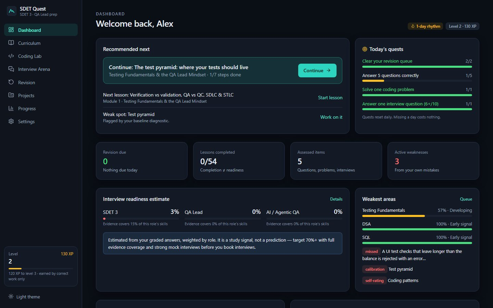

- 24 modules · 54 lessons · 169 graded questions · 35 coding/SQL/Java problems · 49 interview questions · 81 flashcards
- 529 curriculum topics traced to content ([docs/requirements-traceability.md](docs/requirements-traceability.md))
- 18 interactive visualizations, including the test pyramid, HashMap buckets, race conditions, WebDriver flow, BrowserContext isolation, the CI pipeline, Kafka, the agent loop, MCP and sharding
- 40 curated YouTube videos, each checked to exist and to allow embedding
- A phone **scroll feed**: swipe through lesson cards, quizzes and flashcards instead of reels. Installable and works offline.
- No account, no server, no paid APIs. Everything runs in the browser.

## Contents

- [Screenshots](#screenshots)
- [Quick start](#quick-start)
- [How to use it](#how-to-use-it)
- [What's inside](#whats-inside)
- [Honest by design](#honest-by-design)
- [Security and privacy](#security-and-privacy)
- [Tech stack](#tech-stack)
- [Scripts](#scripts)
- [Project structure](#project-structure)
- [Documentation](#documentation)
- [Content and licensing notes](#content-and-licensing-notes)

## Screenshots

Each lesson moves through **Learn → Visualize → Understand → Practice → Build → Interview**.

| Visualize: step-through diagrams | Understand: graded questions with follow-up answers |
|---|---|
| 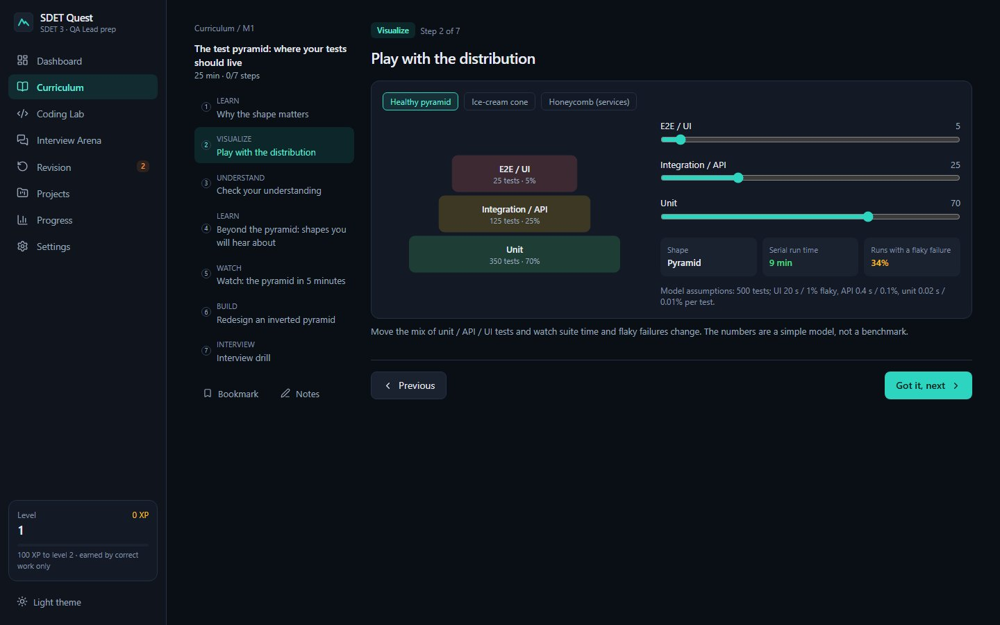 | 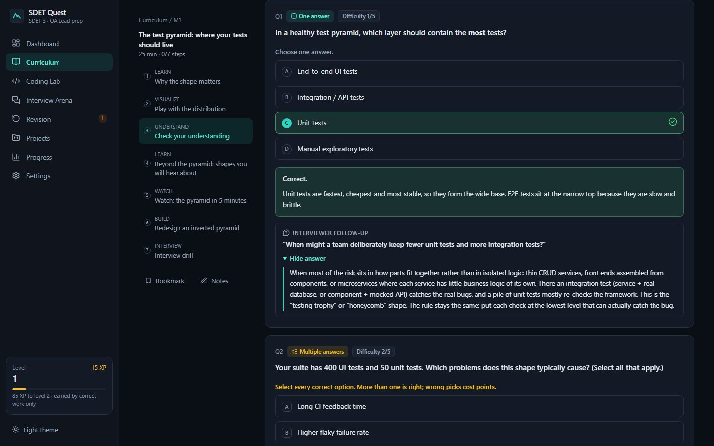 |
| **Coding Lab: JS/TS runs against real tests** | **SQL Lab: real SQLite in the browser** |
| 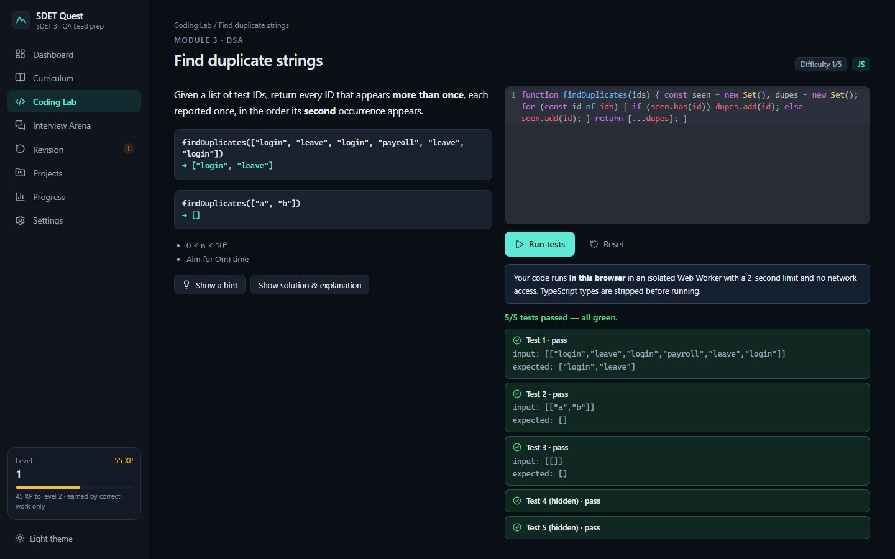 | 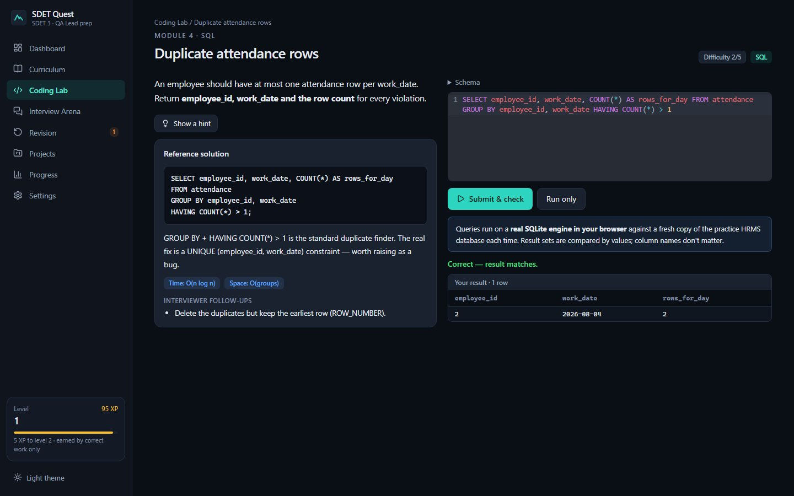 |
| **Interview drills: rubric feedback** | **Curriculum: 24 modules with prerequisites and mastery** |
| 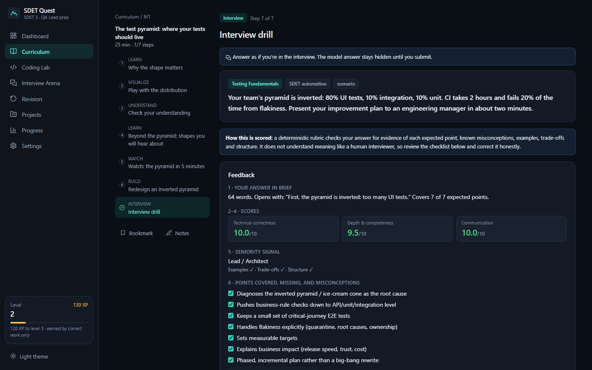 | 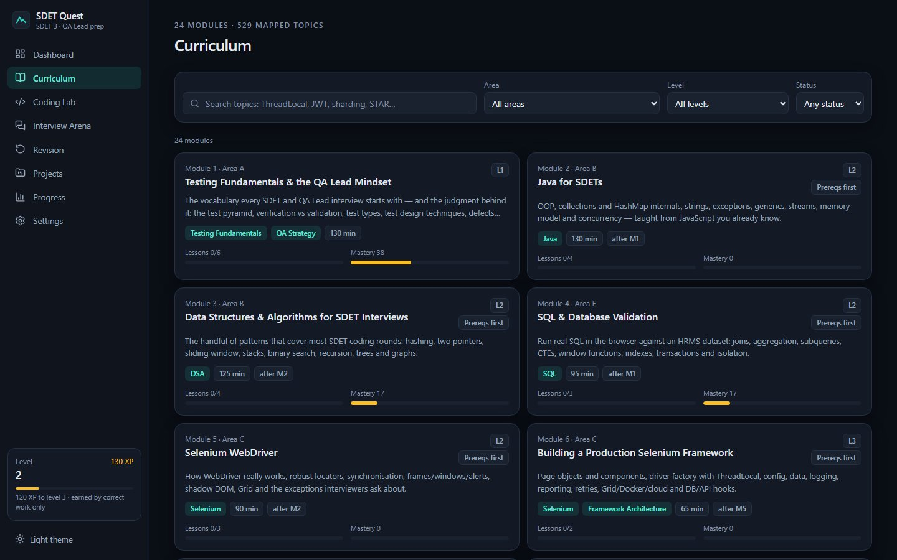 |
| **Revision: spaced repetition and weakness queue** | **Progress: readiness and skill tree** |
| 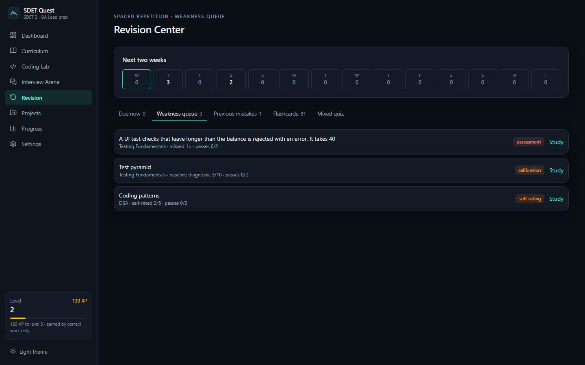 | 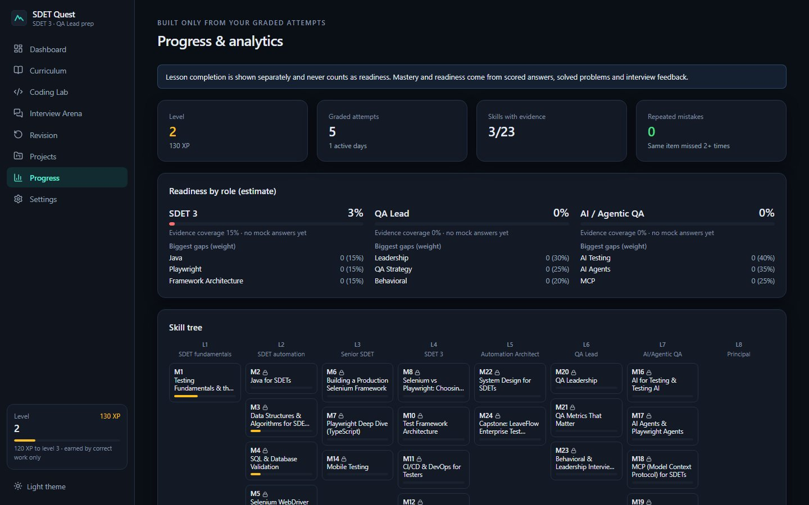 |
| **Light theme** | **Mobile** |
| 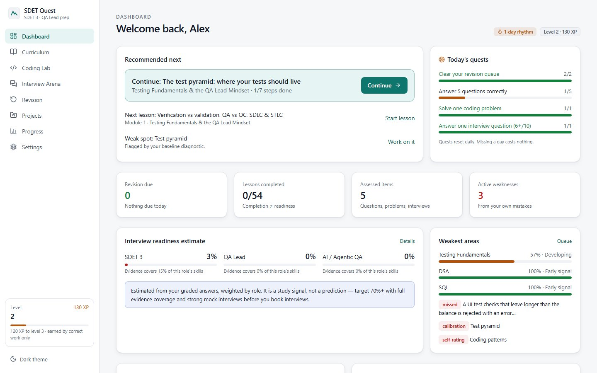 | 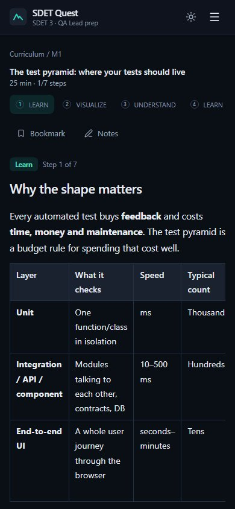 |

**The phone feed**

| Lesson card | Table as a slide deck | One-tap quiz | Throw the card: true or false | Flashcard |
|---|---|---|---|---|
| 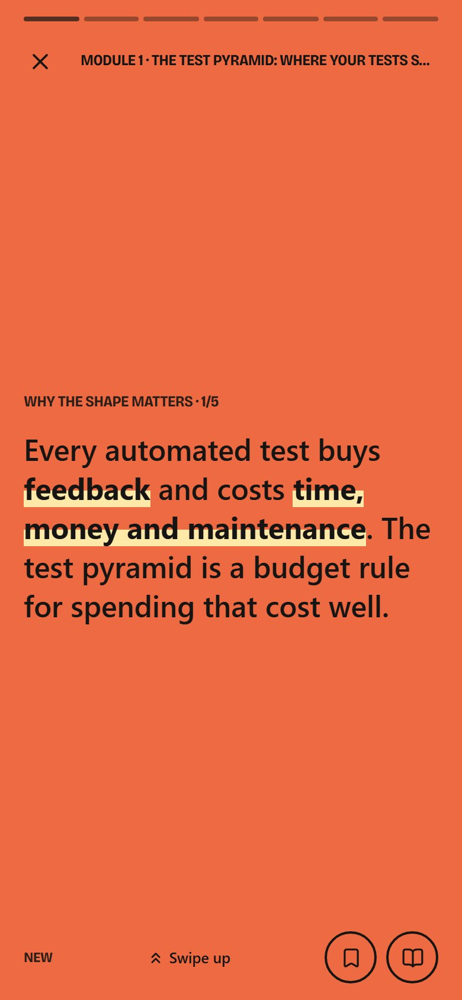 | 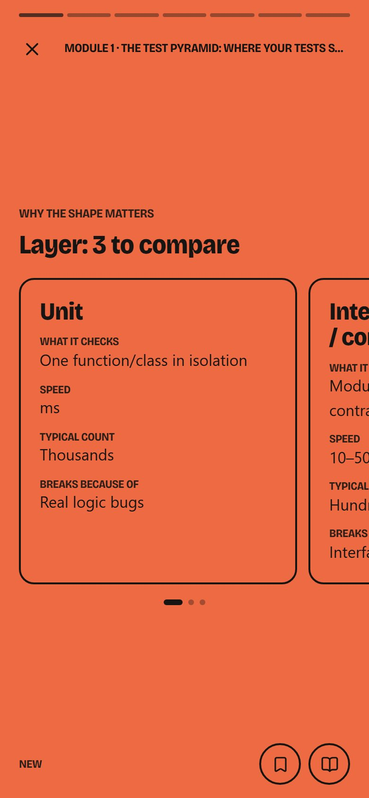 | 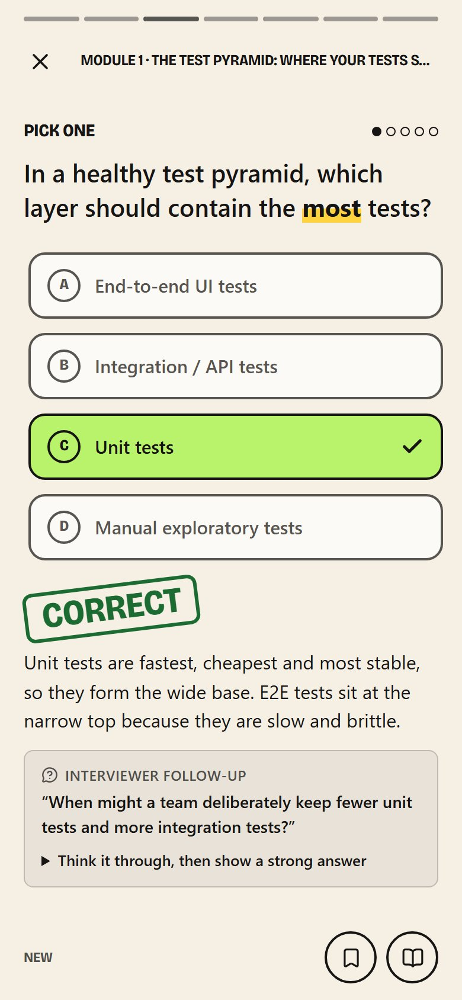 | 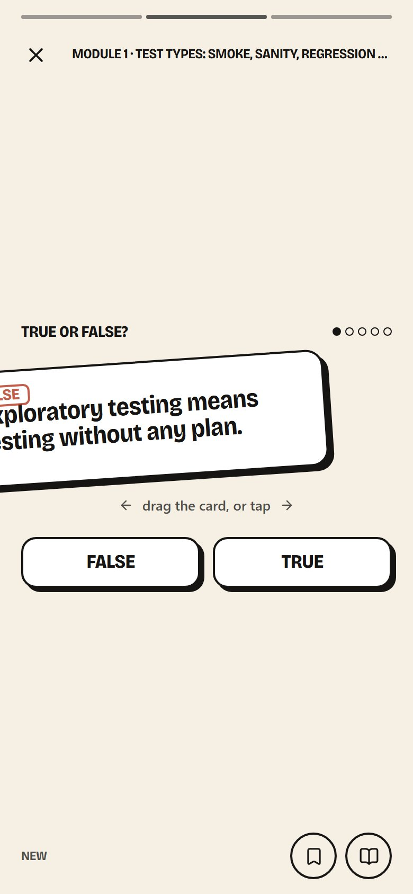 | 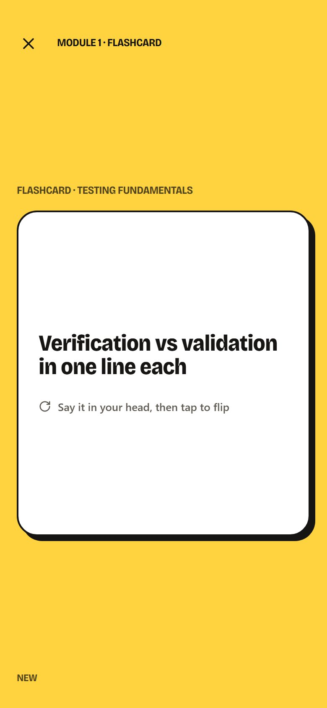 |

The screenshots use the public example profile ([`profile.example.json`](profile.example.json)), not real personal data. To regenerate them, see [Scripts](#scripts).

## Quick start

You need Node.js 20 or newer (tested with Node 24) and npm.

```bash
npm install
```

```bash
npm run dev
```

Open http://localhost:5173. Progress is saved in your browser's local storage.

> **Windows PowerShell:** if `npm` fails with "running scripts is disabled on this system", either run `npm.cmd install` / `npm.cmd run dev`, or allow signed local scripts for your user once:
>
> ```powershell
> Set-ExecutionPolicy -Scope CurrentUser -ExecutionPolicy RemoteSigned
> ```

### Personalise it (optional)

Go to **Settings → Import profile pack** and choose a profile JSON file. A pack holds three things:

- CV facts, which are shown during behavioral practice.
- Baseline diagnostic scores.
- Self-ratings.

The scores and self-ratings seed your weakness queue and revision schedule. See [`profile.example.json`](profile.example.json) for the format.

`profile.local.json` is git-ignored. It is for your own data and must never be committed or deployed. The public build contains no personal data, and a unit test enforces this.

## How to use it

0. **On a phone, open the Feed and scroll.** Install it from the browser menu ("Add to Home screen") so it opens like an app; see [docs/deployment.md](docs/deployment.md#install-on-a-phone).
1. **Start on the Dashboard.** It recommends one next step, in this order: revision that is due, a lesson to re-learn after repeated mistakes, a lesson to continue, then the next lesson.
2. **Work through a lesson.** Read, step through the diagram, answer the questions, then do the practice problem and the interview drill. Answers stay hidden until you have attempted them. In a quiz, a round marker means **one answer** and a square marker means **multiple answers**. After you check an answer, open the interviewer follow-up to see a strong model answer.
3. **Practise in the Coding Lab.** JS/TS solutions run against hidden test cases. SQL runs against a fresh copy of an HRMS practice database on every run.
4. **Rehearse in the Interview Arena.** Pick a mode, answer out loud or in writing, and read the 10-part feedback. Timed "boss" mocks simulate a full round.
5. **Come back for Revision.** Anything you miss goes into the weakness queue and onto a spaced schedule. A few minutes a day beats a weekend cram.
6. **Back up your progress** from Settings (export to JSON) before you clear your browser data or switch machines.

## What's inside

| Page | What it does |
|---|---|
| Feed | A full-screen reel: one idea per card, one swipe per card. Revision that is due comes first, then weak spots, then new lesson cards. Quizzes lock in on one tap, true/false is a card you throw left or right, flashcards flip, tables become sideways slide decks |
| Dashboard | Recommended next step, daily quests, readiness estimates per role, weakest areas, recent performance |
| Curriculum | Search and filter 24 modules by area, level and status |
| Learning Studio | Each lesson follows Learn → Visualize → Understand → Practice → Build → Interview; answers are hidden until you attempt |
| Coding Lab | JS/TS problems run in an isolated Web Worker; SQL runs on in-browser SQLite against an HRMS dataset; Java problems are self-reviewed (not executed) |
| Interview Arena | 12 modes, including timed "boss" mocks; one question at a time; 10-part rubric feedback; STAR story bank |
| Revision | Spaced repetition (1 → 3 → 7 → 21 → 45 → 90 days), weakness queue, previous mistakes, flashcards, mixed quizzes |
| Projects | LeaveFlow capstone: 5 phases, 18 tasks with deliverables, acceptance criteria and review checkpoints |
| Progress | Readiness by role, skill tree, mastery table, weekly practice, mock scores, achievements |
| Settings | Theme, motion, video loading, profile pack, export/restore backup, reset |

## Honest by design

- **Interview scoring uses a fixed rubric, not AI.** It looks for evidence of the expected points, misconceptions, examples, trade-offs and structure. You can correct its checklist, which can raise the score by at most 3 points and marks it as self-assessed.
- **Only your first answer is graded.** "Try again" is practice and cannot erase a miss.
- **Mastery comes only from graded attempts.** Reading a lesson or ticking a box does not move readiness. Fewer than three graded items show as "Early signal", not as a verdict. XP is earned once per item, at your best score.
- **Spaced repetition is earned.** A card climbs the ladder only when you answer it on or after its due date. Re-answering early does nothing, and a clear miss resets it.
- **No streak penalties.** Missing a day costs nothing.
- **Java code does not run** in the browser, and those exercises say so.

## Security and privacy

- **Untrusted code is isolated.** Learner JS/TS and SQL run in dedicated Web Workers with a hard timeout. The JS worker removes network APIs (`fetch`, `XMLHttpRequest`, `WebSocket` and others) and is served with `connect-src 'none'`.
- **Strict Content Security Policy.** The app page allows no `unsafe-eval`, and its one inline script is pinned by hash in [`public/_headers`](public/_headers). Only the sandbox workers get the eval/WASM permissions they need, and a unit test guards this.
- **Validated storage.** Saved progress and imported backups are checked against a schema on load. Corrupt data is set aside instead of crashing the app. A banner warns you if browser storage is full.
- **Nothing leaves your browser.** There is no backend, no analytics and no account. Videos use `youtube-nocookie.com` and load only when you click them.

## Tech stack

Vite 6, React 18, TypeScript, Tailwind CSS v4, React Router 7, Zustand (persisted state), Zod 4 (schemas), CodeMirror 6, sql.js (SQLite compiled to WebAssembly) and Sucrase (TypeScript stripping). Tests use Vitest and Playwright.

## Scripts

| Command | Purpose |
|---|---|
| `npm run dev` | Dev server on port 5173 |
| `npm run build` | Typecheck + production build into `dist/` |
| `npm run preview` | Serve the production build on port 4173 |
| `npm run lint` | ESLint |
| `npm run typecheck` | TypeScript (app + config) |
| `npm test` | Vitest unit tests (logic, evaluators, sandbox, content integrity, privacy, security headers) |
| `npm run e2e` | Playwright end-to-end tests on desktop and mobile, plus layout checks at five widths (builds and previews automatically) |
| `npm run check` | Lint + typecheck + unit tests + build |
| `npm run docs:trace` | Regenerate the requirements traceability matrix from the content |
| `npm run verify:videos` | Re-verify all YouTube videos via oEmbed |
| `npm run build:gh-pages` | Build for GitHub Pages (base path from `VITE_BASE_PATH`) with the security policy as a meta tag and an SPA fallback |

The first time you run E2E tests on a new machine, install the browser with `npx playwright install chromium`.

To regenerate the README screenshots (bash):

```bash
SCREENSHOTS=1 npx playwright test e2e/screenshots.spec.ts --project=desktop
```

## Project structure

```text
src/
  pages/        one component per route (Dashboard, LessonPage, Lab, Arena, Revision, ...)
  components/   shared UI: QuestionCard, ProblemWorkspace, InterviewRunner, FollowUp, ...
  content/      typed curriculum data: modules m01-m24, problems, videos, follow-up answers
  lib/          pure logic: spaced repetition, mastery, readiness, recommendations, evaluators
  lib/sandbox/  JS and SQL Web Worker runners
  store/        persisted progress state, schema validation, profile packs
  viz/          interactive SVG visualizations
  layout/       app shell and navigation
tests/unit/     Vitest
e2e/            Playwright (journeys, layout, screenshots)
docs/           architecture, roadmap, traceability, deployment, progress
```

## Documentation

- [docs/architecture.md](docs/architecture.md): stack, data model, sandboxing, evaluation and persistence
- [docs/curriculum-roadmap.md](docs/curriculum-roadmap.md): modules, levels, learning order and progression
- [docs/requirements-traceability.md](docs/requirements-traceability.md): every topic mapped to its module, assessments and status
- [docs/deployment.md](docs/deployment.md): free hosting options, phone install and a step-by-step checklist
- [docs/security.md](docs/security.md): protections, the latest review and known limits
- [docs/feed-design.md](docs/feed-design.md): product brief and design rules for the phone feed
- [docs/progress.md](docs/progress.md): what is done, verified, partial and planned
- [docs/source-inventory.md](docs/source-inventory.md): the source material this was built from

## Content and licensing notes

Lessons, questions, problems and visualizations are original. Videos are third-party YouTube content, embedded with `youtube-nocookie.com` and loaded only on click. They remain the property of their creators.

No open-source license has been chosen yet, so all rights are reserved by default.
